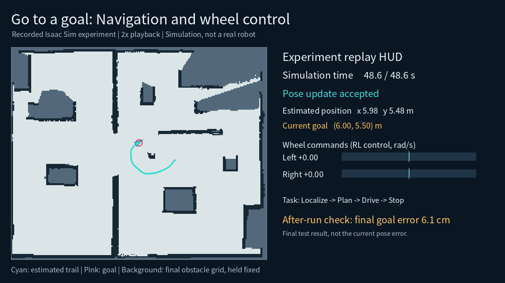

# JetBot Navigation

Hey everyone! This is where we'll keep the code, demos, and ideas for our JetBot project.

The idea is to let a small robot look around a room, work out where it is, and move to a place we choose on a map. We're using Isaac Sim to try things out, with visual SLAM for location, an obstacle grid for planning, and a learned wheel controller for movement.

We're still choosing our project topic. This platform gives us something to build on together, whether we end up exploring rooms, delivering items, or helping someone find an object.



## Start here

- **Want to see what we've been working on?** Read the [introduction and watch the demos](docs/introduction.md), or open the [Notion page](https://www.notion.so/3fe8ca099c5481afb10ed85bae7115e7).
- **Want to try the code?** Follow the [setup guide](docs/setup.md). The 2D demo works without Isaac Sim or a GPU.
- **Want to run the Isaac demo?** Follow the [saved-room guide](docs/isaac-sim.md).
- **Want to help or suggest a topic?** Take a look at [how we work together](CONTRIBUTING.md) and the [roadmap](docs/roadmap.md).

## Try the 2D demo

Use Python 3.12 on Linux. From the repository folder:

```bash
git clone https://github.com/henry753951/jetbot-navigation.git
cd jetbot-navigation
python3.12 -m venv .venv
.venv/bin/python -m pip install -r requirements-lock.txt
.venv/bin/python -m pip install --no-deps -e .
.venv/bin/python scripts/prepare_demo.py
export JETBOT_HOST=192.168.50.78  # Change this to your computer's LAN address.
bash scripts/start_console.sh
```

Open `http://192.168.50.78:8790`, using the same address you set above. Click a free area to choose a goal, or try exploration. This is the lightweight 2D practice environment; the Isaac version has its own guide above.

## Where things live

| Folder | What you'll find |
| --- | --- |
| `jetnav/` | Mapping, localization, planning, control, and console code |
| `scripts/` | Supported setup, simulation, SLAM build, and evaluation commands |
| `configs/` | Camera settings and SLAM configuration |
| `assets/` | Our generated room and baseline grid |
| `examples/pretrained/` | Small wheel policy and its training results |
| `tests/` | Tests for navigation, mapping, localization, and recovery |
| `docs/` | Introductions, setup, architecture, research, and results |
| `outputs/` | Your own generated maps and run results; created locally |

Saved SLAM maps and matching scene files are available in [Releases](https://github.com/henry753951/jetbot-navigation/releases). They stay together as a versioned bundle so everyone can start with the same setup.

## Where we are now

We've tested saving and reloading a visual map, navigating to selected goals, and stopping at the destination in Isaac Sim. Three recorded routes finished about 6–14 cm from their goals. The current obstacle map uses simulated depth. Longer exploration runs and deployment on Jetson Nano are the next things to work on.

See the [architecture](docs/architecture.md), [recorded results](docs/results/README.md), and [SLAM reading list](docs/research/slam-reading.md) for more detail.

## Working together

Feel free to open an issue with an idea, a question, or something that isn't working. We can use issues to agree on a small task, then review the change in a pull request. The templates will help us keep the useful details in one place.

Project code is provided under [GPL-3.0](LICENSE). See [third-party notes](THIRD_PARTY.md) for dependencies and simulator assets.
