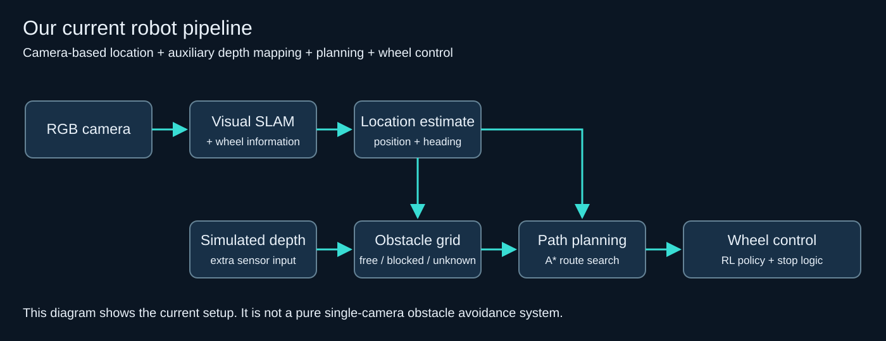

# How the pieces fit together

Camera images go into ORB-SLAM3. The location estimate is combined with wheel odometry, then used with simulated depth to update an obstacle grid. A* finds a route through that grid, and the controller produces left and right wheel commands.

| Area | Main files | A good first task |
| --- | --- | --- |
| Room and simulation | `jetnav/room.py`, `scripts/isaac_run.py` | Change the room layout in a separate scene |
| Visual localization | `jetnav/slam_service.py`, `scripts/slam_sequence.cc` | Understand a localization request and response |
| Pose and map coordinates | `jetnav/fusion.py`, `jetnav/pose_anchors.py`, `jetnav/map_identity.py` | Follow how camera pose becomes robot pose |
| Obstacles | `jetnav/mapping.py`, `jetnav/navigation.py` | Visualize free, occupied, and unknown cells |
| Planning and exploration | `jetnav/navigation.py`, `jetnav/exploration_state.py` | Compare frontier choices |
| Wheel control | `jetnav/rl.py` | Compare a trained policy with a simple controller |
| Recovery | `jetnav/recovery.py`, `jetnav/map_correction.py` | Reproduce a rejected pose update |
| User interface | `jetnav/demo.py`, `jetnav/live_console.py` | Improve the goal-selection interface |

`ground_plane.py`, `landmark_obstacles.py`, and `monocular_depth.py` contain early camera-only mapping work. They have unit tests, while the main saved-room demo still uses depth from the simulator.

There are two useful starting points: `jetnav.demo` for a small 2D environment, and `scripts/isaac_run.py` for Isaac Sim. The saved-room launcher adds the SLAM service and a matching map bundle.
