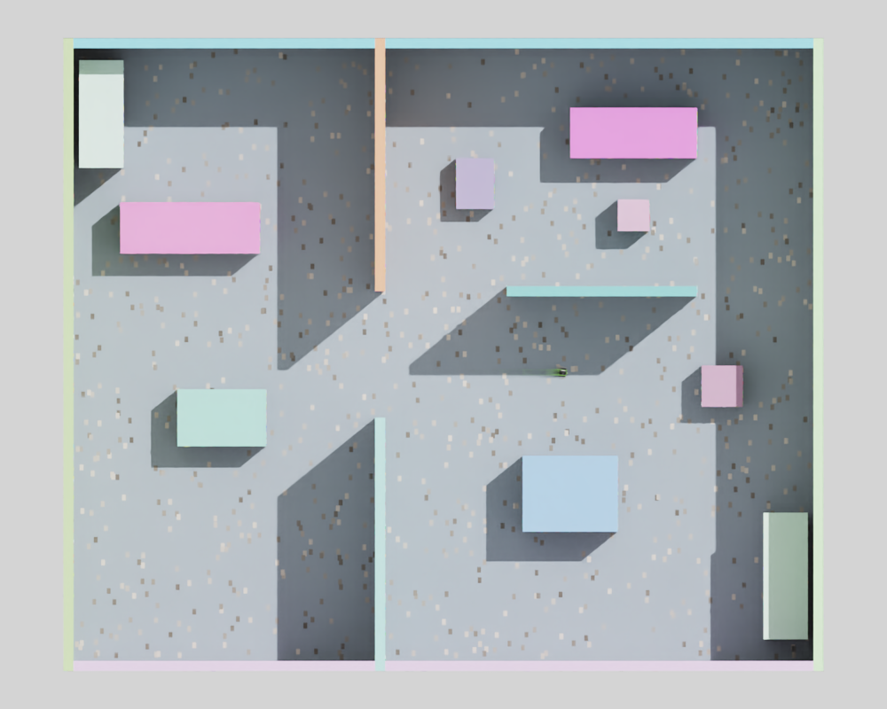
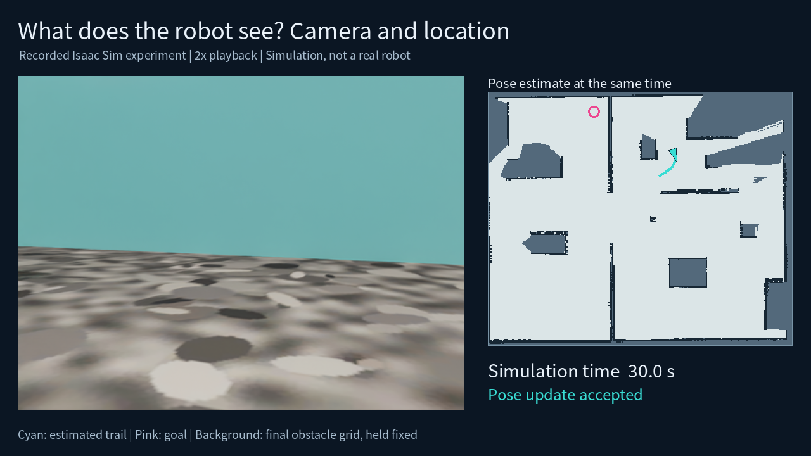
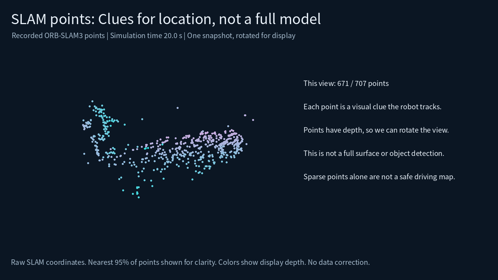
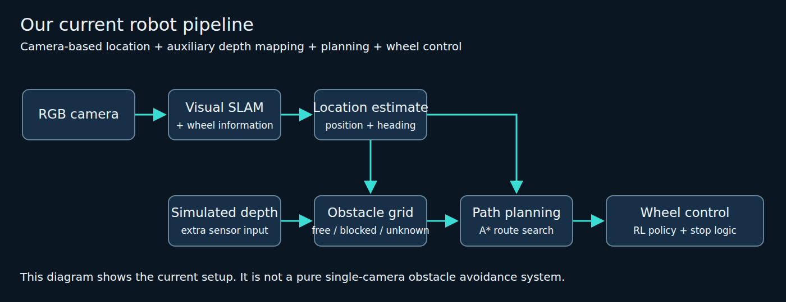
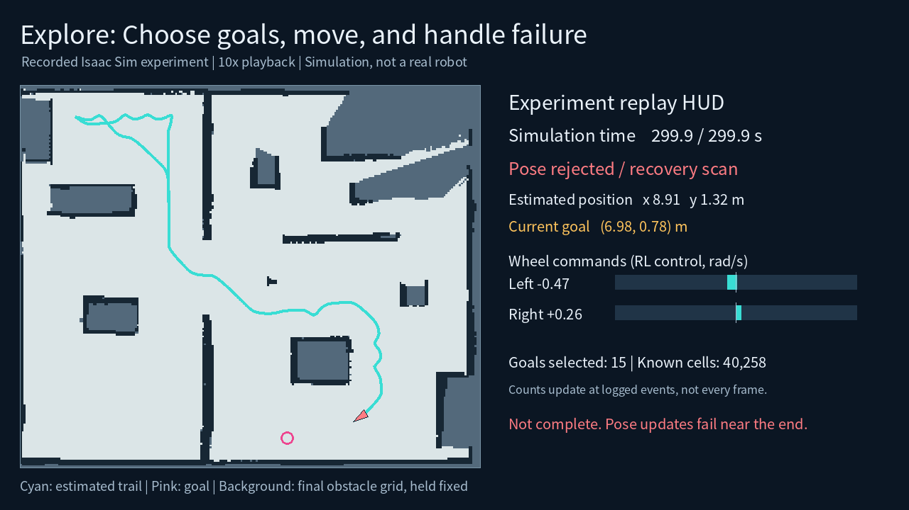

# A look at our JetBot project

Hey everyone! I wanted to share what I've been working on with JetBot and give you a quick look at the platform.
We're still figuring out our project topic, so I thought we could start by looking at what these tools can do. I've put some pictures and short videos below to make things easier to follow. If SLAM and robot navigation are new to you, that's okay — I'll explain them as we go.
## Here's the setup
**JetBot** is a small robot with a camera and two wheels. It turns by moving the left and right wheels at different speeds.
I'm using **Isaac Sim** to build a room and try things out. We can move furniture around, add obstacles, and see how the robot behaves. Here's the room I've been using:

The idea is to get the robot to look around, work out where it is, and move to a place we choose on the map.
Later, I'd like to bring this onto a real JetBot with a **Jetson Nano**, the small computer that runs its software. One thing we'll need to figure out is how to keep everything running smoothly on it.
## How does the robot know where it is?
This is where **SLAM** comes in. It stands for *Simultaneous Localization and Mapping*. Basically, the robot builds a map while working out where it is in that map.
Think of walking into a new room. You look around, notice a few things, and start getting a sense of the layout. The robot does something similar.
We're using **visual SLAM**, or **vSLAM**, which uses camera images. It follows things like corners and patterns as the camera moves. You might also see the word **monocular** — that just means using one camera. In our setup, wheel information also helps connect the visual map to distances in meters.
[Watch video](media/01_camera.mp4)

On the left, you can see what the camera sees. On the right, you can follow the robot's estimated movement over the map.
**Localization** means figuring out the robot's position and which way it's facing. **Relocalization** means finding its place again, for example after restarting. I've also tested saving a map and loading it again, so we can return to a room we've already mapped.
## What does a 3D map look like?
A **3D map** stores where things are in space, including their depth and height. There are different ways to build one. The SLAM we're using gives us a set of points called **landmarks** — visual clues that help the robot recognize places.
Here's a rotating view of those points:
[Watch video](media/04_slam_cloud.mp4)

You can think of these as little reference points the robot remembers. If we wanted a more detailed model of the room, we could also explore denser 3D mapping later.
## How does it know where it can drive?
We also need an **obstacle map**. This helps the robot work out where the floor is clear and where something is in the way.
Our setup uses depth from Isaac Sim together with the estimated robot position to build an **occupancy grid**. That's just a map divided into small squares. Each square represents free space, an obstacle, or an area we're still unsure about.
In the pictures, light areas are free space, dark areas are obstacles, and blue-gray areas are unknown. We also leave some extra room around obstacles so the robot's body can fit through.
Then comes **path planning**: choosing a route to the destination. We're using a method called **A**\* to search through the map.
## Pick a place and let it go there
This is the part I wanted to get working first: choose a point on the top-down map, then have the robot find its way there and stop.
[Watch video](media/02_navigation.mp4)

The pink circle is the goal, and the cyan line shows where the robot estimated it had traveled. The bars on the right show the commands sent to each wheel. In this test, it stopped about **6 cm from the goal**.
**Navigation** is the whole process of getting there: knowing where you are, choosing a route, following it, and stopping.
The **controller** handles the wheel commands. We're also trying **reinforcement learning**, or **RL**, for this part. The idea is to let a control policy improve through trials and rewards, so it learns how to move the wheels for the motion we want.
Here's how the parts connect:

## What if we let it explore on its own?
Instead of choosing every destination ourselves, we can let the robot decide where to look next. That's **exploration**.
One useful idea is a **frontier**: the edge between the space we've already mapped and the space we still want to learn about. Moving toward that edge can give the robot a better view.
[Watch video](media/03_exploration.mp4)

This clip shows a five-minute exploration run, sped up so it's easier to watch. It reached eight new observation positions. Near the end, it had trouble with its position estimate and tried turning to find its place again. Making longer runs more reliable is one of the things I'm working on next.
## So, what could our project be?
With these pieces in place, we can start thinking about a situation where the robot would be useful. I had a few examples in mind.
Maybe it's a **delivery helper in a lab**. Someone asks for an item, and the robot brings it to their desk. If a chair is blocking the way, it needs to find another route. We could even add a way to check whether the person has picked up the item before it leaves.
Or maybe it's a robot that **learns a new room**. We place it somewhere unfamiliar and let it explore. The interesting part could be how it chooses where to go, or how quickly it can build a useful map.
Another possibility is **finding something**. Say someone is looking for a toolbox. The robot could move around, recognize it with the camera, and mark its location on the map.
We could also try **interacting with a person**. For example, someone gives a signal, the robot works out who asked for help, and then follows that person. That would bring in person detection and tracking alongside navigation.
These are a few starting ideas. I'd like to hear what situations you think would be interesting, too. Even a simple story like “someone needs this, so the robot helps by doing that” gives us something to build on.
Take a look at the clips when you have time, and we can talk about which direction we'd like to try together.
